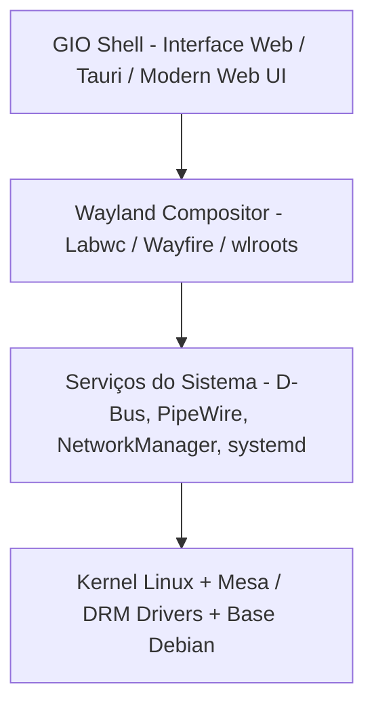

# 🪐 GIO Os - Documento de Arquitetura e Especificação Técnica

O **GIO Os** é um sistema operacional moderno baseado no ecossistema Linux (Debian), projetado para entregar uma experiência visual fluida, elegante e responsiva com foco em usabilidade, aceleração gráfica e design de ponta.

---

## 🏗️ 1. Visão Geral da Arquitetura

O sistema é dividido em 4 camadas fundamentais:



### Camada 1: Núcleo do Sistema (Base OS)
- **Distribuição Base:** Debian (Minimal / Netinst).
- **Init System:** `systemd` para inicialização paralela e gerenciamento de serviços.
- **Áudio:** `PipeWire` + `WirePlumber` (baixa latência e compatibilidade ALSA/PulseAudio/JACK).
- **Rede & Dispositivos:** `NetworkManager` + `BlueZ` (Bluetooth) + `UPower` (bateria) + `UDisks2` (armazenamento).
- **Gerenciador de Login:** `greetd` configurado com sessão Wayland autologin ou GIO Greeter.

### Camada 2: Servidor Gráfico (Wayland)
- **Protocolo:** Wayland nativo (sem tearing, suporte a gestos e multi-monitor escalável por display HiDPI).
- **Compositor Recomendado:** 
  - `labwc` (leve, empilhamento/floating windows, compatível com especificações wlroots) ou `wayfire` (efeitos visuais 3D com shaders).
  - Suporte ao protocolo `wlr-layer-shell` para ancorar painéis, dock, notificações e papéis de parede.

### Camada 3: GIO Shell (Desktop Environment)
- **Engine UI:** **Tauri v2 (Rust + Webview)** ou Web Runtime otimizado.
- **Frontend:** HTML5, CSS3 avançado (Glassmorphism, backdrop-filter, animações CSS, variáveis de design tokens), TypeScript / JavaScript moderno.
- **Comunicação de Baixo Nível (IPC / D-Bus):**
  - Gerenciamento de rede (listar redes WiFi, conectar via `nmcli` / D-Bus).
  - Controle de brilho (`brightnessctl`) e áudio (`wpctl` / PipeWire).
  - Lançador de aplicativos (parsing de arquivos `.desktop` em `/usr/share/applications`).
  - Monitoramento de bateria, CPU e memória.

### Camada 4: Ferramenta de Geração da ISO (Build Pipeline)
- Ferramenta: `live-build` / `debootstrap` + `squashfs-tools` + `xorriso` (UEFI / BIOS).
- Configuração de instalador gráfico opcional (`Calamares`).

---

## 📂 2. Estrutura do Repositório

```text
GIO Os/
├── ARCHITECTURE.md          # Este documento
├── README.md                # Apresentação e guia de inicialização
├── build/                   # Scripts de construção do sistema e geração de ISO
│   ├── build-iso.sh         # Script mestre para compilar a ISO bootável
│   ├── config/              # Configurações de pacotes e repositórios
│   └── rootfs-overlay/      # Arquivos que serão mesclados na raiz do OS (/etc, /usr, etc.)
├── shell/                   # Código-fonte da interface GIO Shell
│   ├── src/                 # Componentes Web (Dock, TopBar, Launcher, ControlCenter)
│   ├── styles/              # Design System (tokens, cores, glassmorphism)
│   ├── src-tauri/           # Backend nativo em Rust para comunicação com o Linux
│   └── package.json
└── assets/                  # Wallpapers, logos, ícones e temas
    ├── wallpapers/
    ├── icons/
    └── branding/
```

---

## 🎨 3. Design System do GIO Os
- **Paleta de Cores:** Estilo dark mode espacial com toques de neon sutil, efeitos translúcidos e desfoque gaussiano (`backdrop-filter: blur(20px)`).
- **Tipografia:** Famílias sans-serif modernas e legíveis (Inter, Outfit ou Roboto).
- **Micro-interações:** Transições elásticas (spring animations), hover states dinâmicos e feedback tátil/visual.
