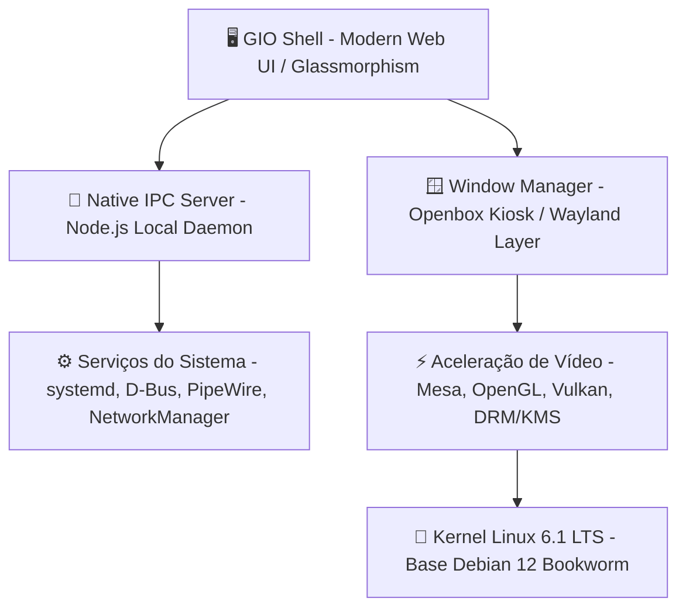

<div align="center">

# 🪐 GIO Os
### *Next-Generation Linux Operating System & Glassmorphism Desktop Environment*

[](https://github.com/rickystudios-hub/gio-os/releases)
[](https://www.debian.org)
[-818cf8?style=for-the-badge&logo=linux)](https://github.com/rickystudios-hub/gio-os)
[](LICENSE)
[](https://github.com/rickystudios-hub/gio-os/actions)

<p align="center">
  <b>Um sistema operacional completo, rápido e translúcido alimentado por tecnologias Web modernas, aceleração nativa por hardware e o poder incondicional do kernel Linux.</b>
</p>

[✨ Funcionalidades](#-funcionalidades) •
[🏗️ Arquitetura](#️-arquitetura-do-sistema) •
[🚀 Como Iniciar](#-como-iniciar) •
[💿 Instalador & ISO](#-compilação-da-imagem-iso) •
[📥 Releases](https://github.com/rickystudios-hub/gio-os/releases)

---

</div>

## 🌌 Visão Geral

O **GIO Os** é uma distribuição Linux moderna projetada desde a base para superar os limites dos ambientes de desktop tradicionais. Combinando o robusto ecossistema **Debian 12 GNU/Linux** a uma camada gráfica ultra-responsiva (**GIO Shell**), o sistema oferece uma experiência imersiva com suporte nativo a **Glassmorphism**, aceleração gráfica por hardware (Mesa/DRM) e execução nativa de comandos e processos em tempo real.

Diferente de simulações ou protótipos puramente visuais, o GIO Os é **100% conectado ao Linux real**: o terminal executa seu bash físico, o gerenciador de arquivos lê seu disco rígido e o monitor de recursos gerencia os processos reais do seu processador.

---

## ✨ Funcionalidades em Destaque

### 🪐 Aether Glass Design System
* **Desfoque em Tempo Real:** Filtros dinâmicos `backdrop-filter: blur(28px)` com transparências calibradas para contraste e legibilidade.
* **TopBar Inteligente:** Exibição de relógio/calendário, status de rede (Wi-Fi), volume de áudio, bateria e alternância instantânea entre 4 Workspaces virtuais.
* **Dock Flutuante com Micro-Interações:** Animações elásticas, indicadores de aplicativos abertos e tooltips contextuais.
* **Launchpad em Tela Cheia:** Grade de aplicativos com busca instantânea ao pressionar a tecla `Super` (Windows Key).
* **Central de Controle (Quick Settings):** Painel popover para ajustes de brilho, volume, modo escuro/claro e controle de conexão.

### ⚡ Aplicativos Nativos do Sistema
| Aplicativo | Descrição |
| :--- | :--- |
| **📟 GIO Terminal** | Shell interativo conectado diretamente ao `/bin/bash` do Linux, com suporte a comandos reais (`apt`, `git`, `python`, `htop`, etc.) e banner informativo Neofetch. |
| **📁 Arquivos GIO** | Gerenciador de arquivos completo com navegação por diretórios reais (`/home`, `/etc`, `/usr`), criação de pastas e exclusão de itens. |
| **🌐 Navegador Web** | Browser integrado com suporte a navegação por proxy seguro e atalho para abrir páginas com aceleração de hardware. |
| **📈 Monitor do Sistema** | Gráficos de carga de CPU (%), consumo de memória RAM e tabela de processos ativos com suporte a encerramento de tarefas via sinal `SIGTERM`. |
| **💻 GIO Studio** | Editor de código-fonte moderno com realce de sintaxe e salvamento direto no sistema de arquivos. |
| **💿 Instalador GIO Os** | Assistente intuitivo com modo Live (para testar na RAM) ou instalação completa no disco com particionamento automático GPT/UEFI. |
| **🧮 Calculadora & Mídia** | Calculadora de operações rápidas, visualizador de papéis de parede e sintetizador de áudio ambiente. |

---

## 🏗️ Arquitetura do Sistema



---

## 🚀 Como Iniciar

### 1. Testar Localmente no seu Linux Atual
Se você já está em uma distribuição Linux (Ubuntu, Debian, Zorin, Fedora), pode rodar a interface e o backend nativo agora mesmo:

```bash
# Iniciar o servidor e a interface em tela cheia (modo aplicação nativa)
./run-gio-os.sh
```
*Acesse também via navegador em: [http://localhost:4567](http://localhost:4567)*

---

### 2. Testar no Emulador QEMU (Máquina Virtual)
O repositório inclui um utilitário completo para testar a ISO bootável em uma máquina virtual com aceleração KVM e disco virtual de teste:

```bash
# Compila a ISO (se necessário) e abre a VM com disco de 20GB e aceleração gráfica
./test-qemu.sh
```

---

## 💿 Compilação da Imagem ISO

Para gerar uma imagem ISO bootável independente (**UEFI e BIOS**) para instalar em qualquer computador ou pendrive:

1. **Instale as ferramentas de build no host:**
```bash
sudo apt update
sudo apt install -y debootstrap squashfs-tools xorriso grub-pc-bin grub-efi-amd64-bin mtools
```

2. **Execute o compilador mestre:**
```bash
sudo ./build/build-iso.sh
```

A imagem gerada estará disponível em:
`dist/gio-os-1.0-amd64.iso`

### Gravar em Pendrive USB:
```bash
sudo dd if=dist/gio-os-1.0-amd64.iso of=/dev/sdX bs=4M status=progress oflag=sync
```
*(Substitua `/dev/sdX` pelo identificador do seu pendrive USB)*

---

## ⚙️ Requisitos do Sistema

| Componente | Requisito Mínimo | Recomendado |
| :--- | :--- | :--- |
| **Processador** | 64-bit Dual-Core 1.6 GHz | 64-bit Quad-Core 2.0 GHz ou superior |
| **Memória RAM** | 2.0 GB | 4.0 GB ou superior |
| **Armazenamento**| 15 GB de espaço livre | 30 GB SSD / NVMe |
| **Placa de Vídeo** | Compatível com OpenGL 2.1 / Mesa | Aceleração 3D Intel / AMD / NVIDIA |
| **Inicialização** | UEFI de 64 bits ou BIOS Legada | UEFI com Secure Boot configurável |

---

## 🤝 Contribuições

Contribuições são muito bem-vindas! Consulte o arquivo [CONTRIBUTING.md](CONTRIBUTING.md) para detalhes sobre nosso fluxo de desenvolvimento, padrões de commit e como enviar Pull Requests.

---

## 📄 Licença

Este projeto é distribuído sob a licença **MIT**. Consulte o arquivo [LICENSE](LICENSE) para obter mais informações.

<div align="center">
  <sub>Construído com paixão pela comunidade GIO Os.</sub>
</div>
